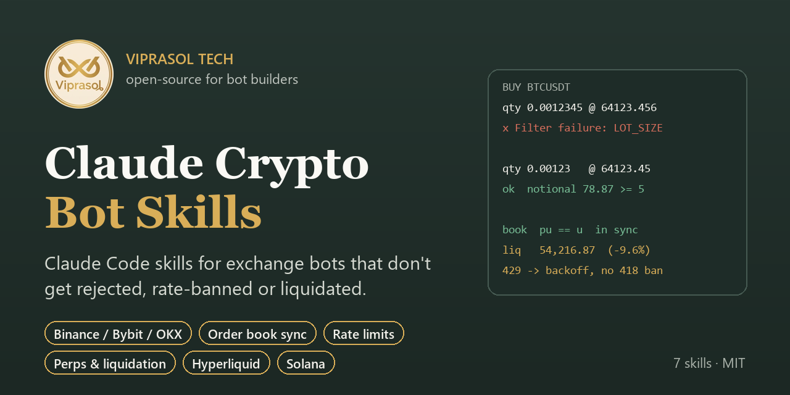

<div align="center">



### Claude Code skills for building crypto trading bots that work

**Signing · precision filters · rate limits · order book sync · order lifecycle · perps & liquidation · Hyperliquid & Solana**<br>
Not "AI picks your trades" - the engineering that keeps a bot alive in production.

[](https://github.com/Viprasol-Tech/claude-crypto-bot-skills/stargazers)
[](LICENSE)
[](https://code.claude.com/docs/en/skills)
[](#-whats-inside)
[](https://github.com/Viprasol-Tech/claude-crypto-bot-skills/actions/workflows/ci.yml)

[Quick start](#-quick-start) · [What's inside](#-whats-inside) · [Examples](#-just-ask) · [Scripts](#-bundled-scripts) · [Changelog](CHANGELOG.md)

</div>

---

## 💬 Just ask

Install once, then talk to Claude Code normally. The right skill loads by itself.

```text
> Binance rejects my order with "Filter failure: LOT_SIZE". Fix the sizing code.
> I get -1022 invalid signature since January. What changed?
> Our bot got a 418 IP ban. Add proper rate limiting.
> Build a local order book for ETHUSDT futures that never drifts.
> The bot sometimes places the same order twice after a timeout. Fix it.
> Where is my liquidation price for 1 BTC long at 60k, 10x isolated?
> Port this Binance bot to Hyperliquid - I keep getting nonce errors.
> My Jupiter swaps sometimes execute twice. Why?
```

## 📦 What's inside

| Skill | What it does |
| --- | --- |
| 🔑 **`exchange-api-auth`** | Binance HMAC/RSA/Ed25519 (and the 2026 percent-encode-before-signing change), Bybit v5, OKX v5, Coinbase ES256 JWTs, Kraken nonces, clock sync and key hygiene. |
| 🎯 **`order-precision`** | tickSize, stepSize, NOTIONAL, PERCENT_PRICE_BY_SIDE and the Bybit/OKX/Hyperliquid equivalents - Decimal rounding in the safe direction. |
| 🚦 **`rate-limits`** | Binance weight (6000/min), order counts, 429 -> 418 bans, Bybit and OKX limits, token buckets and moving polling to streams. |
| 📚 **`orderbook-sync`** | Binance spot (`U`/`u`) and futures (`pu`) book maintenance, gap detection, resync, crossed-book and staleness checks. |
| 🔁 **`order-lifecycle`** | Client order IDs per venue, timeouts as "unknown", partial fills, the 2026 Binance listenKey removal, futures `algoOrder` for stops, reconciliation and kill switches. |
| 📉 **`perps-risk`** | Linear/inverse PnL, funding (8 h vs. Hyperliquid's hourly oracle funding), margin tiers, and Binance's and Bybit's liquidation formulas. |
| ⛓️ **`dex-bots`** | Hyperliquid signing, agent wallets, nonces, precision and dead-man's switch; Jupiter Swap API V2, blockhash expiry, safe re-signing and Jito bundles. |

Facts were checked against Binance, Bybit, OKX, Coinbase, Kraken, Hyperliquid,
Jupiter, Solana and Jito documentation in **November 2026**.

## ⚡ Quick start

**Option A: Claude Code plugin (recommended)**

```bash
claude plugin marketplace add Viprasol-Tech/claude-crypto-bot-skills
claude plugin install crypto-bots@claude-crypto-bot-skills
```

Want every Viprasol plugin? Add the [Viprasol marketplace](https://github.com/Viprasol-Tech/claude-plugins) once:
`claude plugin marketplace add Viprasol-Tech/claude-plugins`, then
`claude plugin install <plugin>@viprasol`.

**Option B: installer** (copies the skills to `~/.claude/skills`)

```bash
git clone https://github.com/Viprasol-Tech/claude-crypto-bot-skills
cd claude-crypto-bot-skills
bash install.sh                                        # macOS / Linux
powershell -ExecutionPolicy Bypass -File install.ps1   # Windows
```

No API keys, no network calls. The scripts need only Python 3.10+.

## 🧰 Bundled scripts

**`order_precision.py`** - know before you send:

```text
$ python order_precision.py --side BUY --price 64000 --qty 0.00005 --tick 0.01 --step 0.00001 --min-notional 5
status    WILL BE REJECTED
problem: notional 3.2 below minNotional 5 (need qty >= 0.00008)
```

**`perps_calc.py`** - the exchanges' own liquidation formulas (it reproduces
Binance's and Bybit's published worked examples):

```text
$ python perps_calc.py liq-binance --side long --qty 1 --entry 60000 --wallet 6000 --mmr 0.004
liquidation_price   54216.8675
distance_pct        -9.6386
```

**`book_sync.py`** - replay a snapshot and diff stream and see exactly where a
book would have drifted (exit code 3 = resync needed).

## ⚠️ Disclaimer

Engineering guidance for developers, **not financial advice**. Trading crypto,
especially with leverage, can lose more than you expect; test on testnets or
demo accounts first. Exchange APIs change often - check the current docs and
changelogs. Never paste API keys, secrets, private keys or seed phrases into a
chat. Viprasol Tech is not affiliated with any exchange or protocol mentioned here.

## 🤝 Contributing

Corrections with a link to the exchange's docs or changelog are the most
valuable contribution. See [CONTRIBUTING.md](CONTRIBUTING.md) and run
`python tests/validate_repo.py` before opening a PR. More free Claude Code packs
from Viprasol:
[claude-tradingview-automation-skills](https://github.com/Viprasol-Tech/claude-tradingview-automation-skills) ·
[claude-trading-skills](https://github.com/Viprasol-Tech/claude-trading-skills) ·
[claude-voice-agent-skills](https://github.com/Viprasol-Tech/claude-voice-agent-skills) ·
[claude-india-stack-skills](https://github.com/Viprasol-Tech/claude-india-stack-skills) ·
[claude-fintech-skills](https://github.com/Viprasol-Tech/claude-fintech-skills) ·
[claude-video-editing-skills](https://github.com/Viprasol-Tech/claude-video-editing-skills).

## 📬 Contact — Viprasol Tech Private Limited

Need a trading bot, market maker, arbitrage system or exchange integration
built and run? That is what we do.

- 🌐 Website: [viprasol.com](https://viprasol.com)
- ✉️ Email: [support@viprasol.com](mailto:support@viprasol.com)
- 💬 Telegram: [t.me/viprasol_help](https://t.me/viprasol_help) · 📱 WhatsApp: +91 96336 52112
- 🐙 GitHub: [@Viprasol-Tech](https://github.com/Viprasol-Tech) · 💼 [LinkedIn](https://www.linkedin.com/in/viprasol/) · 𝕏 [@viprasol](https://twitter.com/viprasol)

## License

[MIT](LICENSE) © 2026 Viprasol Tech Private Limited
